  

## Hi, I'm Alan

- **B.Eng. in Multiplatform Software Development** at UTEZ (expected Dec 2027)
- Former **Full-Stack Developer intern** at TREND BM – Corporate Clothing Group: B2B automation and web development with NestJS, Next.js and PostgreSQL
- **Current quest:** leveling up in **AWS Cloud**
- Open to relocation · Spanish (native) · English (B2)
- Let's connect on [LinkedIn](https://www.linkedin.com/in/alan-salgado-arias-29821a408/)

  
  

## Main quest · Corporate Clothing Group landing page

[Corporate Clothing Group](https://corporateclothinggroup.com/en) (CCG) is a B2B company that designs, produces and manages complete uniform programs for industrial, hospitality, healthcare, corporate and school clients in Mexico, Switzerland and the USA. I built its multilingual landing page (EN, ES, DE, FR) during my internship: a clear story from the problem to the solution, industries served, selected work, a step-by-step process and a proposal request flow.

<!-- Add a screenshot: upload ccg-preview.png to the repo and uncomment the next line

 -->

`Next.js App Router` `TypeScript` `Tailwind CSS` `shadcn/ui` `Framer Motion` `i18n EN/ES/DE/FR`

## Tech stack

  

<b>Currently learning</b>

   
  EC2 · S3 · Lambda · IAM

  

  

